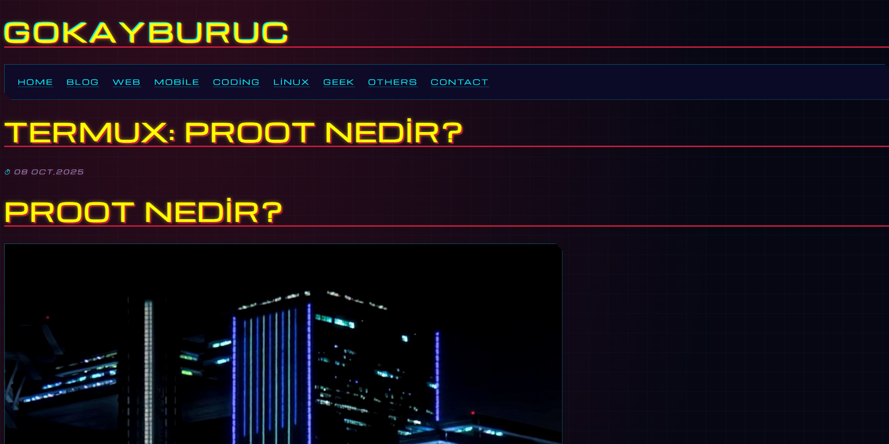
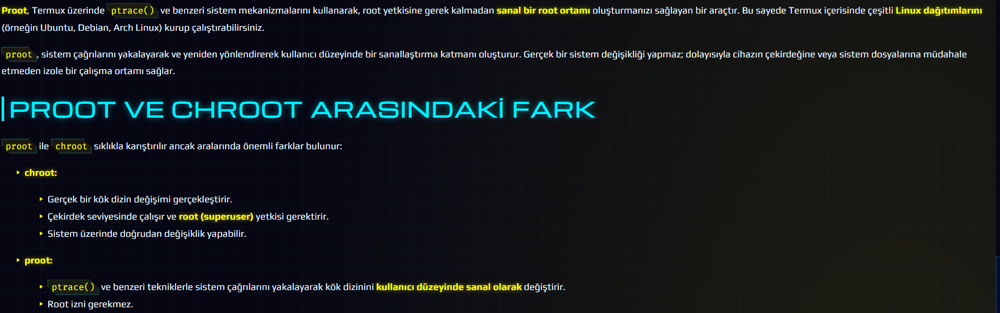
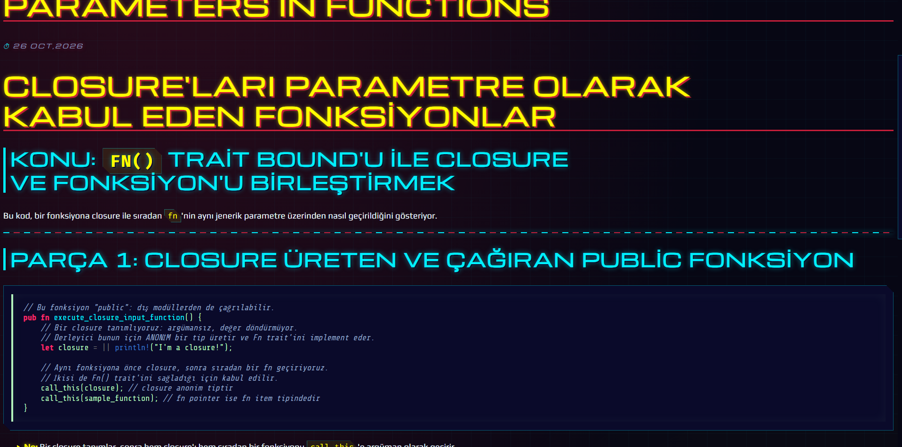
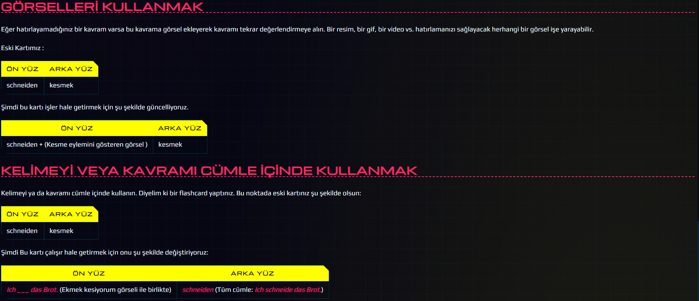

# ⚡ NEON//GRID — Cyberpunk Theme for Bear Blog

A glitchy, neon-soaked cyberpunk theme for [Bear Blog](https://bearblog.dev). Dark tones, HUD-style callouts, brutal headings, and vivid accents — built with pure CSS, no JavaScript required.


## 🖼 Preview

Screenshots:





## 🎨 Color Palette

| Token             | Hex       | Usage                                |
| ----------------- | --------- | ------------------------------------ |
| `--color-yellow`  | `#FFFF00` | Blog title, bold text, glow accents  |
| `--color-bg-2`    | `#0A0A2A` | Panels, code blocks, deep dark base  |
| `--color-red`     | `#C41E3A` | HUD blockquotes, h1 shadows, buttons |
| `--color-mint`    | `#B2F2BB` | Code text, h4, ins                   |
| `--color-cyan`    | `#00F0FF` | Links, h2, grid lines                |
| `--color-magenta` | `#FF2A6D` | Italic text, h3                      |

## ✨ Features

- 🌆 **Dark cyberpunk background** — neon grid with red/yellow radial glows
- 📺 **HUD-style blockquotes & callouts** — clipped corner panels with `◤ SYS.MSG ▸` system tags
- 💥 **Brutal headings** — every heading level (h1–h6) has a unique treatment: glitch shadows, colored borders, `//` and `▶` prefixes
- 🔤 **Futuristic typography** — [Michroma](https://fonts.google.com/specimen/Michroma) for headings, [Play](https://fonts.google.com/specimen/Play) for body — both with full **Turkish character support** (ğ, ş, ı, İ, ç, ö, ü)
- ✨ **Vivid inline text** — glowing yellow bold, neon magenta italic, mint inline code
- 🧩 **Bear-native selectors** — uses only officially documented Bear classes (`.blog-posts`, `.title h1`, `.subscribe`, `.not-found`, `.highlight`, …)
- 🚫 **Zero JavaScript** — 100% CSS, no build step, no dependencies
- 📱 **Responsive** — fluid `clamp()` type scale, mobile-friendly
- 🖱 **Cyber scrollbar** — themed scrollbar with red hover state

## 🚀 Installation

1. Copy the contents of [`theme.css`](theme.css).
2. Open your **Bear Blog dashboard** → **Design**.
3. Paste everything into the **Edit theme CSS** field.
4. Save — done. ⚡

> [!NOTE]
> Fonts are loaded automatically via `@import` from Google Fonts. No extra setup needed.

## 🔧 Customization

All colors, fonts, and effects are exposed as CSS custom properties in the `:root` block:

```css
:root {
  --color-bg: #070714; /* page background */
  --color-yellow: #ffff00; /* accent */
  --color-red: #c41e3a; /* accent */
  --color-mint: #b2f2bb; /* accent */
  --color-cyan: #00f0ff; /* accent */
  --color-magenta: #ff2a6d; /* accent */
  --font-head: "Michroma", "Play", sans-serif;
  --font-body: "Play", "Michroma", sans-serif;
  --glow-y: 0 0 8px rgba(255, 255, 0, 0.55);
}
```

Change a value, save, and the whole theme re-skins instantly.

## 📁 Repository Structure

```text
cyberpunk-bear-theme/
├── theme.css        # the full theme — paste into Bear's "Edit theme CSS"
├── README.md        # this file
├── LICENSE          # MIT license text
└── docs/
    └── screenshot.png
```

## 🧠 Bear Blog Compatibility

Built against the [official Bear Blog styling documentation](https://docs.bearblog.dev/styling/) and compatible with Bear's default templates:

- ✅ Homepage & post lists (`.home`, `.blog`, `.blog-posts`)
- ✅ Posts, pages & custom `class_name` pages (`.post`, `.page`)
- ✅ Syntax-highlighted code blocks (`.highlight`, `.code`)
- ✅ Email subscription page (`.subscribe`)
- ✅ 404 page (`.not-found`)
- ✅ Dark-mode-first (the theme is dark by design)

## 📄 License

Released under the [MIT License](LICENSE). Use it, remix it, ship it.

---

<div align="center">

**`▚ MADE FOR BEAR BLOG ▞`**

_Made with Bear 🐻 + neon_

</div>
